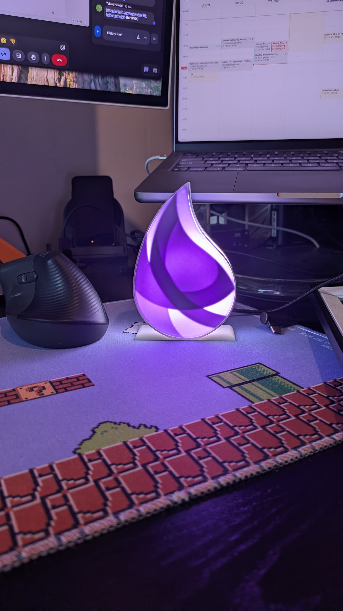

# Elixir Logo Light

[](img/result.png)

This repo contains all the things you need to make your own Elixir light.

To make it from scratch, you need 2 things:

 - 3D print the housing based on the STL files attached in the `3d/` folder.
 - An ESP32 with some LEDs to make it work.

## Printing

All the models for printing are available under `3d`. You will find the STL
files for printing and a 3mf file for opening it in the slicer.

If you just want to print your own light, you should have enough with the .stl
files.

If you don't want to regenerate the files and just want to print it, you can
find all STL files under the `3d/elixir` folder. Notice that the Elixir logo is
mirrored. This is on purpose. The purple lines are inside the enclosure because
they're not that nice to look at.

The Erlang logo can be found under `3d/erlang`.

## Generating the STL file

The STL file generated from the logo is a bit finnicky. However, the new logo is
nice in that is has clear shades of purple. For this logo i did not make any
automated STL generation because it was not necessary. The STL file was
generated as follows.

1. Each shade or purple from the SVG was extracted into its own SVG. You can
   find a script for this under `logo/slice_svg.py`. Running it with `python
   scripts/slice_svg.py logo/logos/elixir.svg --height 118` produces the SVG
   files in `logo/output`.

2. Create a full black version of the SVG (`logo/output/elixir_layer_0.svg`).

3. For each darkness of purple take out that path of the SVG. There are 5
   different shades of purple, so we end up with 5 separate STL files.
    - `logo/output/elixir_layer_1.svg`
    - `logo/output/elixir_layer_2.svg`
    - `logo/output/elixir_layer_3.svg`
    - `logo/output/elixir_layer_4.svg`
    - `logo/output/elixir_layer_5.svg`

4. In Prusa Slicer, these SVGs are stacked on top of eachother. The lightest
   shade of purple at the bottom. Each step in darkness adds an extra layer of
   purple. This is a manual process. The result can be found in
   `3d/elixir/elixir.3mf`.

Note: there were some weird artifacts on the sliced view of this. In the end I
did not end up fixing them and everything came out fine. But, I did let Claude
try and solve it for me by manually creating an `.3mf` file for me. The script
that I uses for this is found under `logo/build_3mf.py`. By running `python
scripts/build_3mf.py logo/logos/elixir.svg` you end up with
`logo/output/elixir.3mf` which you can open in your slicer.

The issue was that stacking these layers on top of eachother in the slicer
causes very tiny (sub 0.01mm) gaps between the layers, and the slicer filled
those. This made the print path less than perfect. In reality you don't notice
them.


## Generating Simple Logos

For simpler logos, like the Erlang and Nerves logo, the process is a bit
simpler.

For the Nerves logo, I started out with the SVG files, so I could generate a
high resolution PNG file.

```bash
cairosvg "logo/logos/nerves_stacked.svg" -o logo/logos/nerves_stacked.png --output-width 2000
```

Then, in the `scripts/main.py` file, replace the filename on line 670 with the
name of the logo you wish to convert.

```bash
python scripts/main.py
```

You should end up with an `.stl` file named the same under `logo/output/`.

I have not made enclosures for anything besides the Erlang and Elixir logo yet.
Feel free to do so and create a PR.

## Programming

I have put in an ESP32 and flashed it with the esphome firmware you can find
under `esphome`. Note that this Esp Home file assumes that red, green, blue, and
white LEDs are all connected to separate pins.

If you would rather skip ESPHome and Home Assistant, `firmware/` holds a tiny
[AtomVM](https://www.atomvm.net) app that simply turns all the LEDs on.
See `atomvm/README.md`.

## The Electronics

The electronics are repurposed PCBs I had lying around. They're circular PCBs
with an ESP32 on top and a USBC connector at the bottom.
The model can be modified in Fusion to remove the placeholders if necessary.

## Contributing

If you have any suggestions, contributions or whatever, you know the drill. If
you have questions on how to make it, you can find me on libera under `m1dnight`
or the Elixir slack.


## Copyright

This logo is from the Elixir Team, and you can't just do whatever you want with
it. Don't get sued, read here: https://elixir-lang.org/trademarks.html